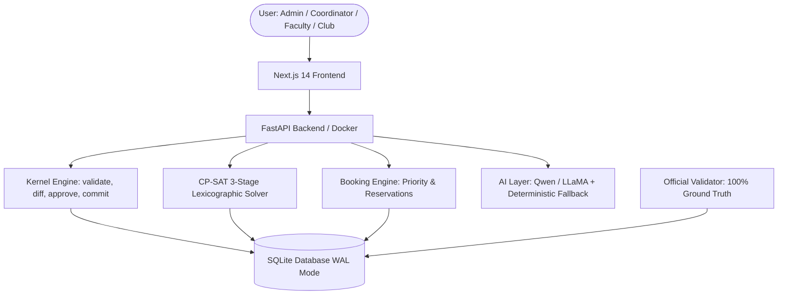

# CIT Scheduler · Chilika Institute of Technology

Scheduling, venue management, and constraint validation engine built for **Tech Zephyr 4.0** (IIT Bhubaneswar). Handles weekly timetables, exam schedules, room bookings, and disruption recovery across **27 rooms**, **40 faculty**, **14 student groups**, **62 courses**, and **189 sessions** (243 teaching hours/week).

---

## Live Deployments & Demo

| Service | URL | Notes |
|---------|-----|-------|
| **Live Web Application** | **[team-alpha-coders-tech-zephyr-40.vercel.app](https://team-alpha-coders-tech-zephyr-40.vercel.app/login)** | Production Next.js 14 client on Vercel |
| **Backend REST API** | **[cit-scheduler-backend.onrender.com](https://cit-scheduler-backend.onrender.com)** | FastAPI on Render (Docker / Python 3.13) |
| **Health & Keep-Warm** | **[cit-scheduler-backend.onrender.com/api/health](https://cit-scheduler-backend.onrender.com/api/health)** | Live health status and solver availability check |
| **Interactive OpenAPI Docs** | **[cit-scheduler-backend.onrender.com/docs](https://cit-scheduler-backend.onrender.com/docs)** | Swagger UI documentation |
| **Video Walkthrough** | **[Watch Demo Video](https://drive.google.com/file/d/1xM0lXjFTZV3uDhDUCvbcrlwQNeUO7fbD/view?usp=sharing)** | Complete feature and evaluation walkthrough |

> [!TIP]
> **Keep-Warm Note**: Free-tier cloud instances sleep after 15 minutes of inactivity. Visiting the live app or pinging `/api/health` keeps the backend immediately responsive.

---

## Verified Evaluation & Validator Benchmark

The official benchmark validator (`validator/validator.py`) runs against all outputs. Both the baseline schedule and post-disruption schedule achieve **zero hard-constraint violations**:

### 1. Baseline Schedule (`exports/schedule.json`)
* **Hard Violations**: **`0`** (All 14 hard constraints H1–H14 strictly satisfied)
* **Soft Penalty**: **`161`**
  * `S1` (Faculty preferred slots avoided): **4**
  * `S2` (Student group idle gaps): **110**
  * `S3` (Student group daily overload >6h): **3**
  * `S4` (Same course twice in one day): **15**
  * `S5` (Room underutilization <50% capacity): **7**
  * `S6` (Late period lecture scheduled P9): **22**
* **Festival Bookings**: **`67.0`** (Maximum theoretical score: 22 approved, 1 alternative offered, 2 rejected, 0 session overrides, **0 priority inversions**)
* **Exam Soft Penalty**: **`0`**

### 2. Disruption Recovery (`exports/schedule_after.json`)
* **Hard Violations**: **`0`**
* **Soft Penalty**: **`160`** (`S1: 4`, `S2: 109`, `S3: 3`, `S4: 15`, `S5: 7`, `S6: 22`)
* **Stability Metric**: **14 sessions moved (1 changed time, 13 room only)** with **0 knock-on moves** (`forced_moves = 14`, `knock_on_moves = 0`).

---

## How to Reset the Demo

To return the application state to pristine hackathon baseline data at any time:

### Option A: From the UI (Admin Role)
1. Log in as `admin@cit.edu` / `admin123`.
2. In the navigation rail, click **Proof Audit** (`/admin/proof`).
3. Scroll to the bottom to **Clean Demo Reset**.
4. Click **"Reset demo to clean state"** and confirm.
5. All database bookings, proposals, and solver states revert immediately to the pristine seed.

### Option B: Via Direct API Call
```bash
curl -X POST https://cit-scheduler-backend.onrender.com/api/admin/reset \
  -H "Authorization: Bearer <ADMIN_TOKEN>"
```

---

## Architecture



---

## Demo Accounts

All accounts are pre-seeded in the database and work on both local and deployed environments:

| Email | Password | Role | Profile Mapping |
|-------|----------|------|-----------------|
| `admin@cit.edu` | `admin123` | Admin | System Administrator |
| `dean@cit.edu` | `dean123` | Admin | Dean of Academic Affairs (Dual-Control Reviewer) |
| `coordinator@cit.edu` | `coord123` | Department coordinator | Department: CSE |
| `faculty@cit.edu` | `faculty123` | Faculty | Faculty ID: F01 (Dr. Mishra) |
| `club@cit.edu` | `club123` | Club representative | Club: Coding Club |

---

## Setup & Local Development

### Prerequisites
Python 3.13 or newer, Node.js 20 or newer, Git.

### 1. Clone and Configure
```bash
git clone https://github.com/bhattasubash/Team-Alpha-Coders-Tech-Zephyr-4.0.git
cd Team-Alpha-Coders-Tech-Zephyr-4.0
cp .env.example .env
```

### 2. Backend
```bash
cd backend
python -m venv venv
# Windows:
venv\Scripts\activate
# macOS/Linux:
source venv/bin/activate

pip install -r requirements.txt
uvicorn app.main:app --reload --port 8000
```
> **Auto-Seeding**: The backend automatically initializes and seeds SQLite (`cit_scheduler.db`) with `cit_public.json` and demo accounts on initial startup.

### 3. Frontend
```bash
cd frontend
npm install
npm run dev
```
Open [http://localhost:3000](http://localhost:3000) in your browser.

---

## Running the Official Validator

Run the organizer-provided validator on the exported baseline schedule:
```bash
python validator/validator.py --data data/cit_public.json --schedule exports/schedule.json
```

For the post-disruption schedule:
```bash
python validator/validator.py --data data/cit_public.json --schedule exports/schedule_after.json --disruption data/sample_disruption.json --baseline exports/schedule.json
```

---

## Repository Structure & Continuity Context

```
├── backend/                  # FastAPI backend and CP-SAT solvers
│   ├── app/
│   │   ├── ai/               # LLM provider & regex fallback parser
│   │   ├── api/              # REST routes & Pydantic schemas
│   │   ├── auth/             # JWT auth & demo account roles
│   │   ├── bookings/         # Festival booking engine & reservations
│   │   ├── db/               # SQLite connection & repository
│   │   ├── kernel/           # Constraint validator mirroring validator.py
│   │   └── solver/           # CP-SAT models (Timetable, Reschedule, Exams)
├── frontend/                 # Next.js 14 App Router UI
│   ├── src/app/              # Dashboard, Timetable, Rooms, Exams, Bookings, Disruption
│   ├── src/components/       # AppShell, Rail, Modals, Session Cards
│   └── src/lib/              # Typed API client
├── prompts/                  # System prompts for booking parser & assistant
├── data/                     # cit_public.json dataset and disruption inputs
├── exports/                  # Verified schedule.json and schedule_after.json
├── validator/                # Official organizer benchmark validator
├── scripts/                  # Automated verification and judge audit suites
└── .ecc/                     # Engineering Continuity Context (handoffs & architecture logs)
```

> **Note on `.ecc/`**: The `.ecc/` directory stores Engineering Continuity Context logs (`handoff.md`), documenting incremental decision records and verification evidence throughout development.
