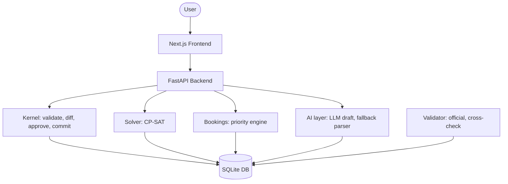

# CIT Schedule

Scheduling and venue management for Chilika Institute of Technology (CIT). Built for a hackathon, this system handles weekly timetables, exam schedules, room bookings, and disruption recovery for 27 rooms, 40 faculty, 14 student groups, 62 courses, and 189 sessions (243 teaching hours per week).

## Architecture



## Tech stack

| Component | Technology | Version |
|-----------|------------|---------|
| Backend | FastAPI | 0.115.0 |
| Solver | OR-Tools CP-SAT | 9.11.4210 |
| Frontend | Next.js | 14.x |
| Styling | Tailwind CSS | 3.x |
| Database | SQLite | 3.x |
| Language (backend) | Python | 3.11+ |
| Language (frontend) | Node.js | 20+ |

## Setup

### Prerequisites

Python 3.11 or newer, Node.js 20 or newer, Git.

### Clone and configure

```bash
git clone <repo-url>
cd cit-schedule
cp .env.example .env
# Edit .env if you want to set an LLM API key (optional).
```

### Backend

```bash
cd backend
python -m venv venv
# Windows:
venv\Scripts\activate
# macOS/Linux:
source venv/bin/activate

pip install -r requirements.txt
uvicorn app.main:app --reload --port 8000
```

### Frontend

```bash
cd frontend
npm install
npm run dev
```

### Seed demo data

```bash
cd backend
python -m scripts.seed_demo
```

This loads the CIT dataset (dataset_id: cit-public-v1) and creates the four demo accounts listed below.

## Demo accounts

| Email | Password | Role |
|-------|----------|------|
| admin@cit.edu | admin123 | Admin |
| coordinator@cit.edu | coord123 | Department coordinator |
| faculty@cit.edu | faculty123 | Faculty |
| club@cit.edu | club123 | Club representative |

## Running the validator

The organiser-provided validator lives in `validator/validator.py`. Run it against a generated schedule:

```bash
python validator/validator.py data/cit_public.json exports/schedule.json
```

For the post-disruption schedule:

```bash
python validator/validator.py data/cit_public.json exports/schedule_after.json
```

Both commands should report zero hard-constraint violations.

## Deployment

### Frontend on Vercel

When importing this repository into Vercel:
1. In **Project Settings** -> **General** -> **Root Directory**, click **Edit**.
2. Set Root Directory to `frontend`.
3. Set the environment variable `NEXT_PUBLIC_API_URL` to your backend URL (e.g. your deployed FastAPI server).
4. Click **Deploy**.

Because the repository separates `frontend` and `backend`, Vercel must be pointed at the `frontend` directory where `package.json` lives.

## Judge quick start

1. **Find a free room.** Log in as admin@cit.edu. Go to Rooms, pick a date and period. The list shows which rooms are open and their capacity.
2. **Read a timetable.** Go to Timetable. Filter by student group (e.g. Y1-A) or faculty name. Each cell shows course, room, and faculty.
3. **Approve a change.** Go to Pending Changes. Click on a proposed schedule change, review the diff (what moves, what stays), and click Approve or Reject.

## Known limitations

- Solver (CP-SAT integration) is stubbed. It returns a placeholder schedule, not an optimized one.
- AI layer (LLM-based natural language booking parsing) is not yet connected. The manual booking form works without an API key.
- Frontend views for exam scheduling and disruption recovery are not built yet.
- Auth is a simple in-memory dict for demo purposes. Not suitable for production.
- No WebSocket or real-time updates. Users must refresh to see changes.
- Export to PDF/ICS is not implemented.
