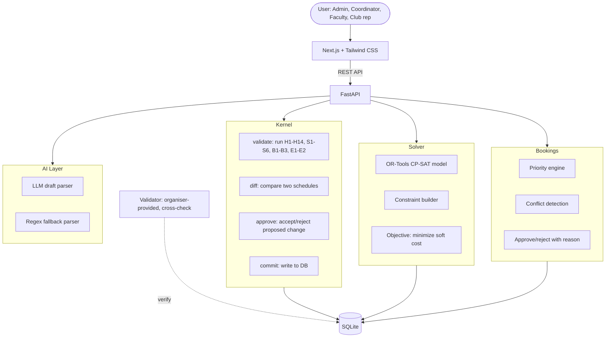

# Architecture

## System diagram

## Pipeline: propose, validate, diff, approve, commit

Every schedule change follows five steps. Nothing is written to the database until all five complete.

**Propose.** A user (or the solver, or the booking engine) creates a proposed schedule. This is a list of session assignments: which session goes in which room at which period on which day. The proposal is stored as a draft.

**Validate.** The kernel runs every constraint check against the proposed schedule. Hard constraints (H1 through H14) must all pass. Soft constraints (S1 through S6) produce a penalty score. If any hard constraint fails, the proposal is rejected with the specific violation codes.

**Diff.** The kernel compares the proposed schedule against the current committed schedule. It produces a list of moves: which sessions changed room, period, or day. This lets reviewers see exactly what changed without reading the full schedule.

**Approve.** An authorized user (admin or coordinator) reviews the diff and approves or rejects it. The kernel checks that the approver has the right role. For booking requests, priority order applies: exam > regular_session > institute_event > guest_lecture > department_event > club_event.

**Commit.** If approved, the kernel writes the new schedule to the database. It also records the diff and who approved it, for audit purposes.

The organiser-provided validator.py can be run at any point as an independent cross-check. We run it after every commit to confirm that our kernel agrees with the official validator.

## Data flow

The CIT dataset (cit-public-v1) contains 27 rooms, 40 faculty, 14 student groups, 62 courses, and 189 sessions. The teaching week is MON through FRI, periods 1 through 9 for teaching and 10 through 13 for events only. Lunch is after period 5 (13:00 to 14:00). Labs must start at period 2 or period 6 only.

Exam week uses MON through SAT, with AM and PM sessions. Room capacity is halved during exams (two students per seat for invigilation spacing).

The booking engine handles 25 requests for Spectra week (BR-04 is cancelled). Each request is checked against room availability, capacity, and priority before approval.
